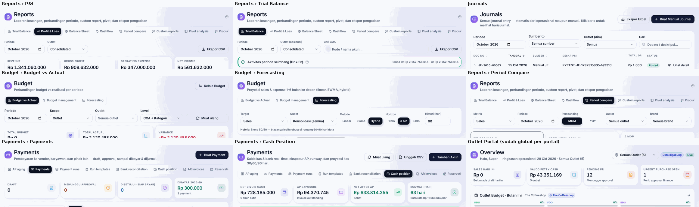

# Analisis konteks Brand/Outlet global — 29 Okt 2026

Status: **analisis + usulan, belum diimplementasi** (menunggu keputusan di Bagian 6).

Pertanyaan: pemilihan outlet masih per halaman? Seharusnya dipilih sekali di level paling atas, lalu semua menu
otomatis memakai outlet/brand itu. Jika satu brand punya banyak toko, pilihan toko baru muncul di level menu.

---

## 1. Kondisi sekarang — ya, masih per halaman



| Temuan | Bukti |
|---|---|
| Hanya **Outlet Portal** yang punya konteks outlet bersama (disimpan, ada di header). Itu pun hanya berlaku di portal Outlet. | `portals/outlet/OutletScopeContext.jsx` |
| Portal lain: **±56 halaman** mengambil daftar outlet dan punya pemilih sendiri. Pilihan tidak terbawa; setiap buka menu kembali ke "Semua". | Finance 12 · Inventory 11 · Procurement 10 · Reports 9 · HR 6 · Admin 5 · Executive 3 |
| Satu konsep, **6 label berbeda** di Keuangan saja. | P&L "Outlet: Consolidated" · TB "Outlet (opsional): Consolidated" · Journals "Outlet (dim): Semua" · BvA "Scope + Outlet: Semua outlet" · Forecasting "Konsolidasi (semua)" · Period Compare "Semua outlet + Semua brand" |
| Level **Brand** hampir tidak bisa dipilih. | Hanya BvA (Scope), Period Compare, Executive |
| Sebagian menu **tidak punya filter sama sekali**. Ada yang memang benar (lihat §3), ada yang kurang. | Payments, AP aging, Cash Position, AR Invoices |
| TopNav hanya menampilkan **chip info read-only** untuk user yang dibatasi ke outlet tertentu. Tidak bisa dipakai untuk memilih. | `components/layout/TopNav.jsx` (`topnav-outlet-scope`) |

## 2. Hierarki data (dari model & data seed)

```
Group  (1 · badan usaha: NPWP, tahun fiskal, mata uang, buku besar)
 └─ Brand  (5 · The Coffeeshop, The Restaurant, The Bistro, The Lounge, The Bakery)
     └─ Outlet / Toko  (model mendukung banyak toko per brand; di seed: 1 toko per brand, namanya sama dengan brand)
```

- User: `brand_ids`, `outlet_ids`, `default_outlet_id`. Manajer outlet = 1 toko; finance/owner/exec = semua.
- Jurnal: **setiap baris** membawa `dim_outlet` + `dim_brand`. Brand dan toko adalah **dimensi (profit center)** di dalam
  satu buku Group, bukan buku terpisah. GL bisa dipotong per brand/toko tanpa memecah akuntansi.
- **Tidak semua transaksi milik toko.** 65 dari 2.810 baris jurnal tanpa outlet: AR invoice/receipt, payroll, payment run,
  payment request, manual JE, saldo awal AP. Rekening bank 2/2 dan kas 5/9 milik pusat. AR invoice 19/19 tanpa outlet.
  → Jika konteks diset ke satu brand/toko, transaksi pusat tidak ikut. Ini **harus terlihat**, bukan hilang diam-diam.

Kesimpulan: untuk Keuangan, **Group adalah entitas/buku**; Brand dan Toko adalah **lensa** di atas buku itu.
Polanya sama dengan ERP lain: subsidiary/company sebagai buku, sedangkan class/location/analytic sebagai dimensi.

## 3. Usulan: satu "Konteks" global di TopNav

### 3.1 Pemilih di TopNav

Posisinya paling kiri pada area judul, sebelum breadcrumb. Breadcrumb lalu terbaca lengkap: *bisnis mana › menu apa*.

```
[Logo FnB Group] │ [🏪 The Coffeeshop · Semua toko ▾]  Finance › Reports › Profit & Loss      [Cari…] 🔔 ✓ ? ☾ (A)
```

Isi dropdown (combobox bertingkat, bisa dicari):

```
┌ Cari brand / toko… ───────────────────┐
│ ● Semua brand (Konsolidasi Group)     │  ← hanya user yang punya akses ke semua
│ ───────────────────────────────────── │
│   The Coffeeshop            3 toko    │  ← klik baris brand = seluruh toko brand itu
│      Coffeeshop Kemang                │
│      Coffeeshop Senopati              │
│      Coffeeshop BSD                   │
│   The Restaurant                      │  ← brand dengan 1 toko = 1 baris saja (tidak dobel)
│   The Bistro                          │
│ ───────────────────────────────────── │
│ ☐ Jadikan default saya                │
└───────────────────────────────────────┘
```

Perilakunya:

- **Tiga level:** Semua (Group) · Brand (semua tokonya) · Toko.
- **Default:**
  - `default_outlet_id`;
  - kalau tidak ada: satu-satunya toko user;
  - kalau semua toko user ada di satu brand: brand itu;
  - selain itu: Semua.
- **RBAC:** daftar hanya berisi brand/toko dalam akses user. User dengan 1 toko melihat label statis (pengganti chip yang ada sekarang).
- **Disimpan per user** (server, `user_preferences` sudah ada), jadi tetap sama di perangkat lain.
- **Satu sumber:** `ScopeProvider` di AppShell (perluasan `OutletScopeProvider` dengan level brand) + hook `useScope()`.
  `OutletScopeProvider` dan `useOutletScope` per halaman diganti oleh hook ini.

### 3.2 Empat jenis halaman

Konteks global tidak diperlakukan sama di semua halaman. Tiap halaman masuk salah satu dari empat jenis:

| Jenis | Perilaku | Tampilan di halaman |
|---|---|---|
| **A. Agregat** (dashboard, laporan, daftar) | Langsung memakai konteks. | Konteks = brand dengan ≥ 2 toko → muncul filter **Toko** di baris filter: "Semua toko The Coffeeshop ▾". Konteks = 1 toko → tidak ada filter outlet sama sekali. |
| **B. Operasional 1 toko** (Daily Sales, Petty Cash, Daily Close, KDO/BDO, Opname) | Butuh tepat 1 toko. | Konteks sudah 1 toko → langsung. Konteks brand/Group → pemilih toko di kanan judul (`OutletScopeCompact` yang sekarang) + "Pilih toko untuk melanjutkan". |
| **C. Tingkat Group** (COA, Period Closing, Tax, Payment run, Bank recon) | Tidak memakai konteks: datanya milik badan usaha. | Pill kecil **"Tingkat Group"** di header + tooltip "Tidak mengikuti pilihan brand/toko", supaya user tidak bingung kenapa angkanya tidak berubah. |
| **D. Form input** (Manual Journal, AR Invoice, Payment Request, Budget, PR) | Konteks hanya mengisi **nilai awal** field Outlet/Brand. | Field tetap bisa diganti dalam akses user. |

Aturan filter Toko di level halaman: **lokal**. Mengganti toko di halaman tidak mengubah konteks global, dan kembali
ke "Semua toko ‹brand›" saat pindah menu. Konteks global hanya diganti dari TopNav, sehingga selalu jelas.

## 4. Peta menu Keuangan

| Menu / tab | Level data | Jenis | Di halaman | Backend sekarang |
|---|---|---|---|---|
| Overview | campuran | A | KPI mengikuti konteks; kas & AP pusat ditandai "Pusat" | `/finance/home` belum terima scope |
| Sales Validation | toko | A | filter Toko bila brand | belum terima outlet |
| Journals | baris JE (dim) | A | filter Toko + opsi **"Pusat (tanpa toko)"** | `dim_outlet` tunggal, tanpa brand |
| Manual Journal | — | D | dim Outlet default dari konteks | ok |
| Payments › Payment Requests | toko (pengaju) | A | filter Toko | `outlet_id` ada; data seed belum terisi |
| Payments › AP aging | vendor (pusat) | C* | default Group; opsional "per toko via GR" | tanpa outlet |
| Payments › Payments, Payment runs, Run templates | rekening pusat | C | pill "Tingkat Group" | tanpa outlet (benar) |
| Payments › Bank reconciliation | rekening bank | C | pill "Tingkat Group" | per rekening (benar) |
| Payments › Cash Position | rekening kas/bank | A | rekening toko mengikuti konteks; rekening pusat di grup "Pusat" | `outlet_id`/`brand_id` **sudah ada**, UI belum memakai |
| Payments › AR Invoices | customer (pusat) | C + D | daftar Group; form: Outlet default dari konteks | tanpa outlet |
| Payments › Deposit Reservasi | toko | A | filter Toko | reservasi punya outlet |
| Fixed Assets | toko (28/28 terisi) | A | filter Toko | `outlet_id` ada |
| Budget › Budget vs Actual | toko/brand/group | A | dropdown "Scope" + "Outlet" **dihapus**; level diturunkan dari konteks | `scope` + `brand_id` sudah ada |
| Budget › Budget management / alokasi | toko | A | matriks hanya toko dalam konteks | ok |
| Budget › Forecasting | toko/group | A | "Konsolidasi (semua)" dihapus; ikut konteks | `outlet_id` |
| Tax & Compliance | NPWP Group | C | pill "Tingkat Group" | benar |
| Period Closing | Group | C | pill "Tingkat Group" | benar |
| Reports › TB, P&L, Cashflow | dim JE | A | filter Toko; konsolidasi menampilkan baris **"Pusat / tidak teralokasi"** | `dim_outlet` tunggal → perlu `brand_id` + multi-outlet |
| Reports › Balance Sheet | Group | C (A parsial) | default Group; per brand/toko diberi label **"parsial"** (bank & utang milik pusat) | `dim_outlet` |
| Reports › Period Compare | dim | A | filter "Semua outlet/brand" diganti filter Toko | `outlet_ids`/`brand_ids` sudah ada |
| Reports › Custom, Pivot, Procurement | dim | A | konteks = filter awal | sebagian ada |
| Chart of Accounts | Group | C | — | benar |

Contoh tampilan P&L dengan konteks "The Coffeeshop" (3 toko):

```
Reports                                                                 [Ekspor CSV]
Laporan keuangan · The Coffeeshop (3 toko)
[Trial Balance] [Profit & Loss] [Balance Sheet] [Cashflow] …
Periode [Oktober 2026]   Toko [Semua toko The Coffeeshop ▾]   Tampilkan [Total | Per toko]
```

Dengan konteks "Semua brand", filter Toko berganti menjadi "Tampilkan [Total | Per brand | Per toko]": kolom
perbandingan, bukan filter. File ekspor selalu mencantumkan konteks di judulnya.

## 5. Catatan teknis yang harus ikut

1. **Penegakan di server:** endpoint GL Finance (`/finance/profit-loss`, `trial-balance`, `balance-sheet`, `journals`)
   tidak memotong data sesuai `outlet_ids` user. Hanya `routers/reports.py` yang melakukannya. Sekarang belum bocor
   karena semua user finance punya akses ke semua toko, tetapi wajib diperbaiki sebelum konteks global dipakai.
2. **Parameter brand & multi-toko:** endpoint GL hanya menerima satu `dim_outlet`. Perlu `brand_id` (lewat `dim_brand`)
   dan `outlet_ids` (koma).
3. **Data demo:** semua brand di seed punya 1 toko dengan nama yang sama dengan brand, jadi kasus "brand dengan banyak
   toko" tidak bisa diuji. Perlu 1 brand demo dengan 2–3 toko.
4. **Transaksi pusat** tidak dialokasikan ke toko (alokasi biaya pusat termasuk logika bisnis, sengaja ditunda). Untuk
   sementara cukup ditampilkan eksplisit sebagai baris/grup "Pusat".

Tahapan bila disetujui:

1. **Fondasi:** `ScopeProvider` + pemilih di TopNav + `useScope()`; Outlet Portal pindah ke sini. Tambah data demo multi-toko.
2. **Keuangan:** halaman jenis A/C/D sesuai §4; parameter backend `brand_id`/`outlet_ids` + penegakan scope di server.
3. **Portal lain** (Inventory, Procurement, HR, Reports, Executive) dengan pola yang sama.
4. Kolom "Per brand / Per toko" di P&L & BvA; konteks di judul file ekspor.

## 6. Keputusan yang dibutuhkan

1. Filter Toko di halaman: **lokal** (usulan) atau mengubah konteks global?
2. Opsi "Semua brand": hanya untuk user yang punya akses ke semua, sedangkan user multi-toko yang terbatas melihat "Semua toko saya". Setuju?
3. Balance Sheet per brand/toko: tampilkan dengan label "parsial" (usulan), atau hanya di level Group?
4. Konteks disimpan per akun di server (usulan) atau cukup per browser?
