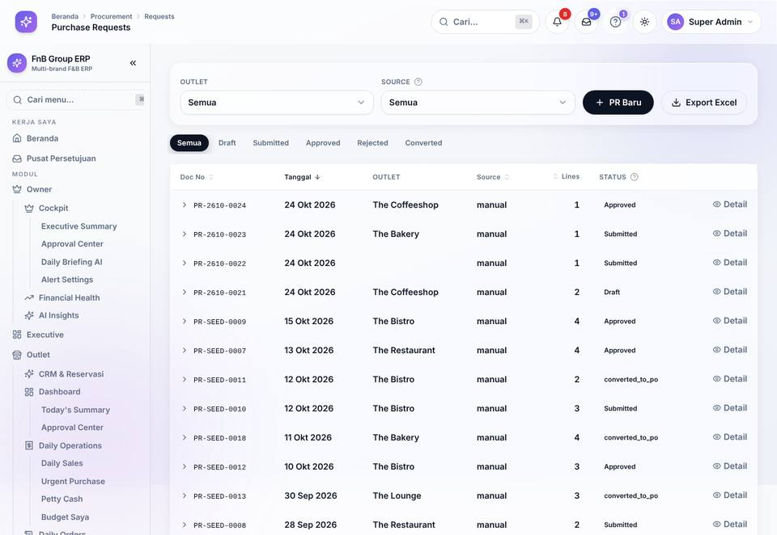
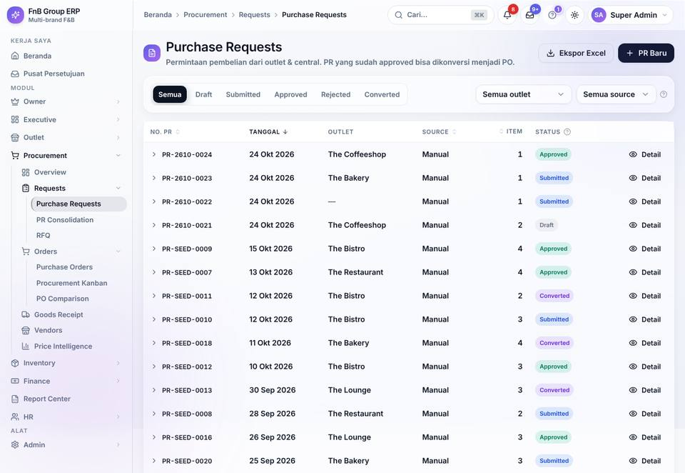
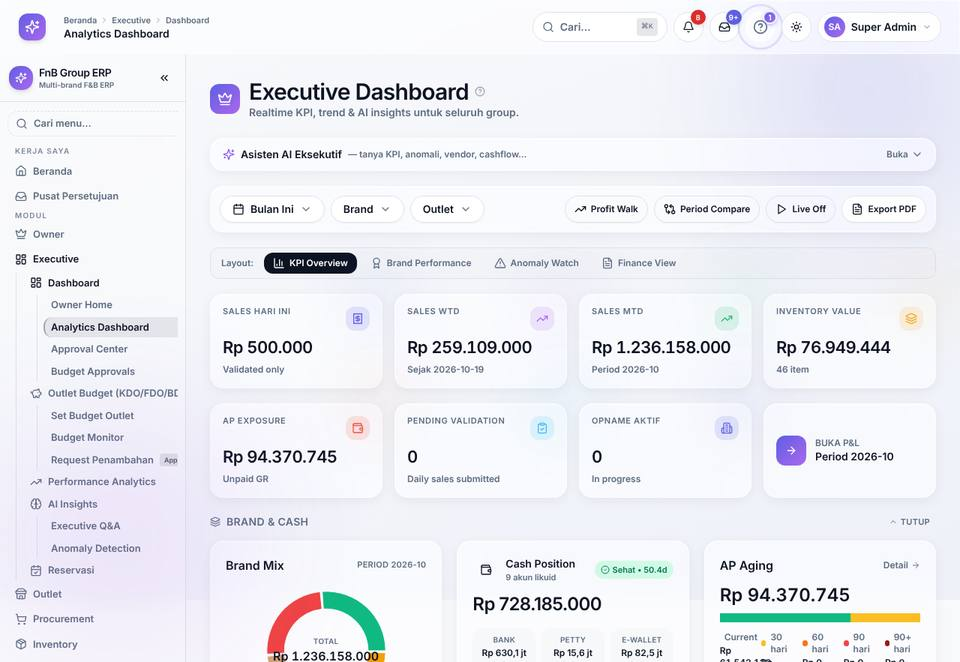
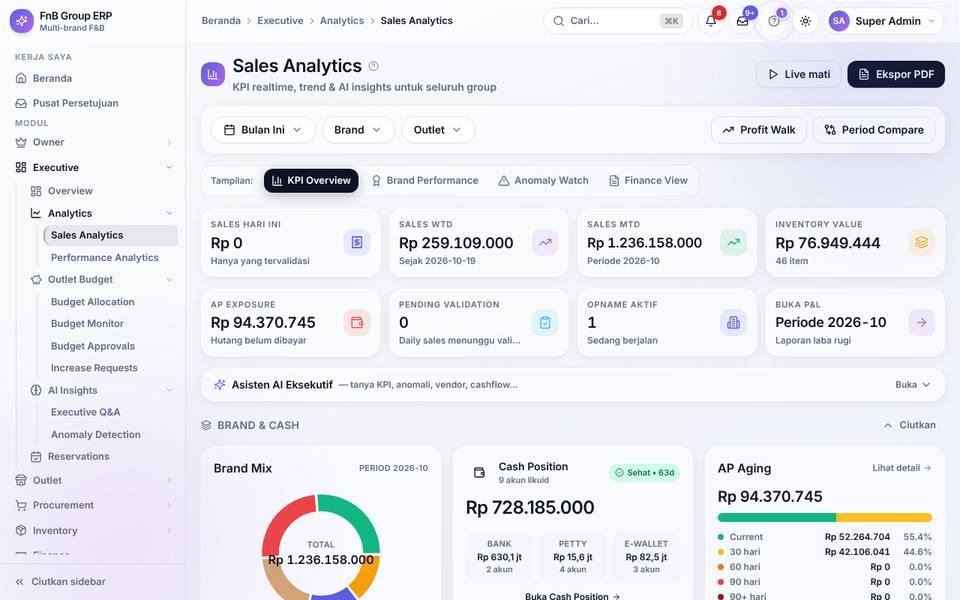
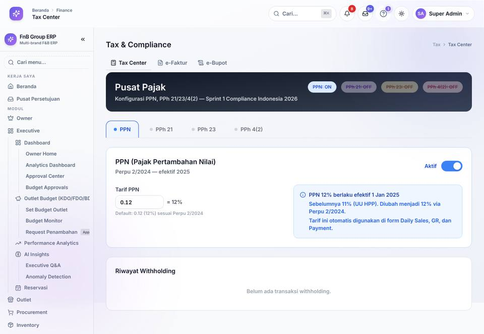
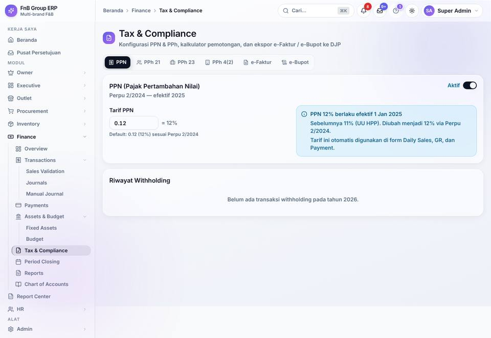
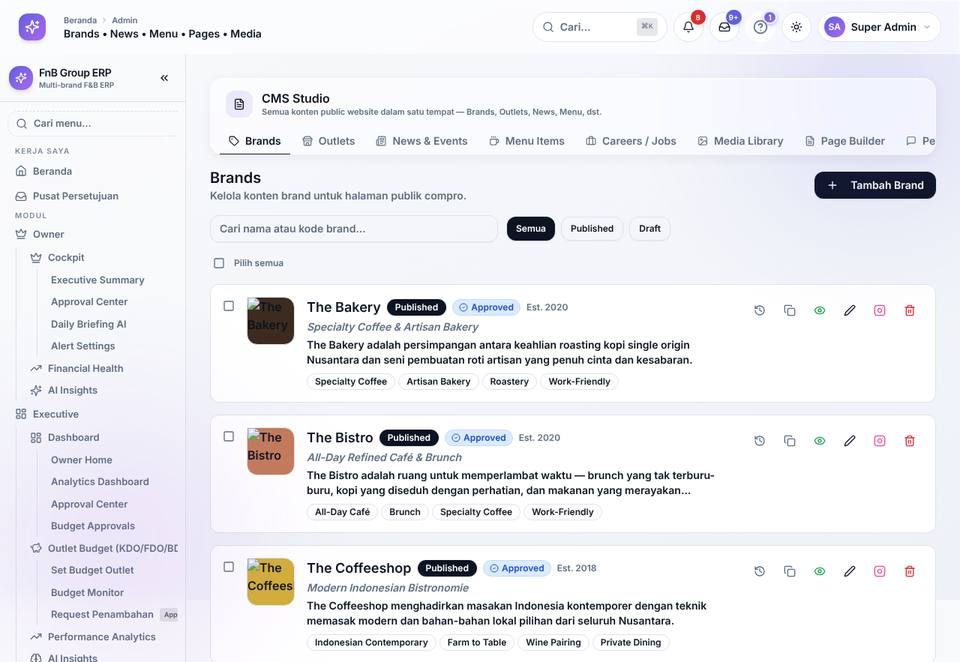
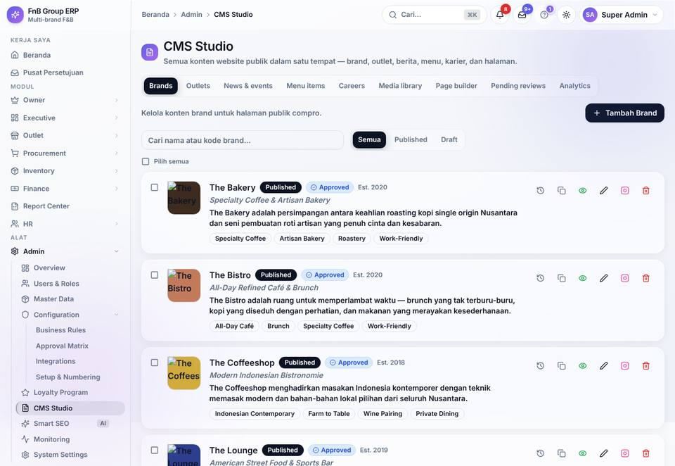

# Laporan Audit UI/UX — FnB Group ERP (2026-10-24)

Audit menyeluruh konsistensi antarmuka: **setiap halaman, tab, form, dan pop-up/dialog** di portal ERP (Owner, Executive, Outlet, Procurement, Inventory, Finance, HR, Admin, Report Center, Pusat Persetujuan) dan shell aplikasi (header, sidebar, menu user, pencarian, notifikasi, tour).

## 1. Ringkasan

- Semua route ERP dirender dan dicrawl sebagai Super Admin pada viewport 1280×800: sebelum **197 route / 709 state**, sesudah **199 route / 810 state** (halaman + setiap tab + setiap dialog yang aman dibuka) dengan screenshot + metrik DOM. Dua halaman detail (Stock Opname, RFQ) baru bisa dicrawl setelah dibuatkan data contoh.
- Temuan otomatis crawler: **1849 → 287** (sebelum → sesudah).
- Temuan global (shell, IA, design system): **51** — semuanya diperbaiki (§3).
- Temuan review visual per halaman: **966** di 9 kelompok portal (§5, detail per halaman di `docs/audit/ui/`).
- Bug fungsional yang ditemukan saat audit UI ikut diperbaiki (mis. dialog konfirmasi yang tidak pernah muncul, link mati, laporan deposit reservasi error 500, data demo yang tidak sesuai skema) — lihat §3 dan §8.

**Cara membaca.** Severity: **P0** = fitur tidak bisa dipakai; **P1** = salah/membingungkan, terlihat di banyak halaman; **P2** = inkonsistensi yang jelas terlihat; **P3** = polesan. Status: *Diperbaiki* = sudah di kode; *Diperbaiki (komponen shared)* = diperbaiki di komponen bersama sehingga berlaku di semua halaman; *Terbuka* = belum, dengan alasan.

## 2. Metode

1. **Crawler DOM** (Playwright) untuk semua route `App.js` + portal router: screenshot full-page, klik setiap tab, buka tombol pembuka dialog yang aman (Tambah/Buat/Edit/Filter/Detail/Export — tanpa aksi destruktif), lalu ukur: judul & <h1>, distribusi ukuran font (<11px), tinggi tombol, tombol ikon tanpa label, padding/radius kartu, baris tab, breadcrumb, overflow horizontal, input tanpa label, font family, error JS/API.
2. **Metrik statis kode** (`frontend/src`): variasi ukuran judul, font <11px, override tombol/tab, padding berlebih, komponen KPI lokal, emoji, route approval duplikat.
3. **Review visual per halaman**: setiap screenshot (halaman, tab, dialog) diperiksa terhadap rubrik `design_guidelines.md` (tipografi, tombol, tab, kartu, form, IA/flow, bahasa, a11y) lalu diperbaiki di kode.
4. **Verifikasi**: build produksi, crawl ulang semua route, gate `audit_tours.py` (0 drift), `ux_audit.py`, `audit_ui_ia.py`.

## 3. Temuan & perbaikan global (shell, IA, design system)

| ID | Area | Kategori | Sev | Temuan | Perbaikan | Status |
|---|---|---|---|---|---|---|
| UX-G-01 | Shell — TopNav + Sidebar | duplikasi | P1 | Logo tampil dua kali: ikon logo di TopNav dan blok brand "FnB Group ERP / Multi-brand F&B ERP" tepat di bawahnya pada header sidebar. | Brand (logo + nama) hanya di TopNav; area brand selebar sidebar (248px/76px) sehingga sejajar. Header brand sidebar dihapus. | Diperbaiki |
| UX-G-02 | Shell — identitas user | duplikasi | P1 | "Super Admin" tampil di pojok kanan atas (UserMenu) dan pojok kiri bawah (footer sidebar dengan avatar, role, tombol logout). | Footer user + logout di sidebar dihapus; identitas & Keluar hanya di UserMenu. Footer sidebar kini hanya tombol "Ciutkan sidebar". | Diperbaiki |
| UX-G-03 | Shell — pencarian | duplikasi | P2 | Dua tombol pencarian membuka palet yang sama: "Cari…" di TopNav dan "Cari menu…" di sidebar. | Satu pemicu pencarian (TopNav, ⌘K). Tombol sidebar dihapus. | Diperbaiki |
| UX-G-04 | Shell — judul halaman | typography | P1 | Judul halaman tidak konsisten: TopNav merender <h1> 14px berisi nama halaman; 14 halaman menampilkan judul yang sama lagi di konten (judul ganda), sementara 143 dari 197 halaman tidak punya <h1> sendiri di area konten (judul berupa h2/teks custom dengan 11 variasi ukuran, atau tidak ada sama sekali). | TopNav hanya menampilkan breadcrumb (Beranda › Modul › Seksi › Halaman); <h1> menjadi milik PageHeader di tiap halaman (token text-xl/2xl semibold). | Diperbaiki |
| UX-G-05 | Shell — tinggi header | layout | P2 | Tinggi header tidak sejajar: TopNav 72px vs header sidebar 64px; tombol header 40px berbeda-beda bentuk. | TopNav 56px, semua kontrol header 36px (search, notifikasi, inbox, bantuan, tema, user). | Diperbaiki |
| UX-G-06 | Shell — padding konten | density | P2 | Padding area konten lg:px-8 py-8 (lebih besar dari token px-5 py-4) — membuang ruang di layar 1280×800. | main#main-content memakai px-3 sm:px-4 lg:px-5 py-3 lg:py-4. | Diperbaiki |
| UX-G-07 | Sidebar — panjang navigasi | ia | P1 | Setiap grup modul yang pernah dibuka tetap terbuka (persist) → sidebar memanjang 4–5 layar (Outlet + Procurement + Finance terbuka bersamaan). | Accordion: hanya satu modul terbuka (modul halaman aktif). | Diperbaiki |
| UX-G-08 | IA — Approval Center | duplikasi | P1 | 8 URL untuk halaman yang sama: "Pusat Persetujuan" (/my-approvals) + "Approval Center" di sidebar Owner, Executive, Outlet, Procurement, Finance, HR (semuanya merender MyApprovals), plus inbox di TopNav. | Satu halaman kanonik /my-approvals ("Pusat Persetujuan"); 6 entri sidebar dihapus; /approvals & /{portal}/approvals di-redirect. | Diperbaiki |
| UX-G-09 | Pusat Persetujuan — delegasi | flow | P1 | Fitur Delegasi Approval (buat/cabut delegasi saat cuti) tidak bisa dijangkau: hanya ada di ApprovalCenter yang tertutup (shadowed) oleh alias route yang selalu merender MyApprovals. Dialognya juga membaca users.data.items padahal API mengembalikan array → daftar user kosong. | Tab "Delegasi" di Pusat Persetujuan (komponen ApprovalDelegations), parsing respons diperbaiki; ApprovalCenter (kode mati) dihapus. | Diperbaiki |
| UX-G-10 | Pusat Persetujuan — filter | flow | P1 | Kartu filter hanya 4 tipe statis (PR, PO, Adj, Adv); 21 Leave Request, Payment Request, Stock Transfer, dll. tidak bisa difilter. Label disingkat ("Adj", "Adv"). Judul h2 16px "My Approvals" berbeda dengan nama menu "Pusat Persetujuan". | Kartu filter dinamis untuk setiap tipe yang punya antrean (CompactStatCard), label lengkap, PageHeader "Pusat Persetujuan", tombol 32px standar. | Diperbaiki |
| UX-G-11 | IA — Report Center | ia | P1 | Portal /reports (katalog + 13 laporan Excel) yatim: tidak ada di sidebar, tidak ada link, tidak muncul di pencarian. Guard frontend memakai prefix permission "reports.*" yang tidak pernah ada → hanya Super Admin yang bisa membuka, padahal backend mengizinkan role finance/executive/procurement. | Modul "Report Center" di sidebar & pencarian; guard memakai permission baca laporan yang sama dengan backend (REPORT_CENTER_PERMS). | Diperbaiki |
| UX-G-12 | IA — sub-halaman hub | ia | P2 | Halaman yang dibuka dari tab hub (/admin/master/vendors, /finance/payment-runs, /hr/payroll, …) dan halaman detail tidak menyorot item sidebar apa pun; breadcrumb berhenti di nama modul. | matchPaths per item hub + satu leaf aktif dari resolveNavContext; breadcrumb "… › Purchase Requests › Detail" untuk halaman detail. | Diperbaiki |
| UX-G-13 | IA — urutan & grouping | ia | P2 | Urutan & grouping tidak mengikuti alur kerja: Outlet diawali "CRM & Reservasi" sebelum Dashboard; HR "Dashboard" berisi Leave Requests + Compensation; RFQ di grup "Workflow" terpisah dari PR→PO; Budget Approvals di grup Dashboard Executive; label "Owner Home" di portal Executive; item tunggal dengan nama berbeda dari seksinya ("Items • Vendors • Outlets • Brands • Employees"). | Urutan per alur kerja (Overview → operasi harian → analitik → konfigurasi), RFQ di Requests, Kanban di Orders, Budget Approvals di Outlet Budget, nama item = nama seksi, badge dekoratif (NEW/HUB/Builder/Approve) dihapus. | Diperbaiki |
| UX-G-14 | IA — bahasa label | language | P3 | Label menu mencampur bahasa dalam satu daftar: "Budget Saya", "Tutup Hari Workflow", "Request Penambahan", "Kelola Lowongan", "Lamaran Kerja", "Ringkasan Reservasi" di antara label Inggris. | Konvensi: nama modul/halaman = istilah ERP Inggris; teks bantuan/aksi/pesan = Bahasa Indonesia. Label menu diseragamkan. | Diperbaiki |
| UX-G-15 | Design system — tipografi | typography | P1 | 268 teks berukuran 8–10px (di bawah batas 11px guideline), 11 variasi ukuran <h1> (text-sm s/d text-5xl), font Cormorant Garamond di halaman Input Poin (melanggar Inter-only). | Batas minimum 11px (codemod 97 file, kecuali angka badge counter), axis chart 11px, PageHeader token, Cormorant dihapus. | Diperbaiki |
| UX-G-16 | Design system — Tabs | tabs | P1 | Komponen Tabs default shadcn (abu-abu h-9) berbeda dengan pill tabs di halaman lain (PortalSubNav, filter status) → 4 gaya tab. | TabsList/TabsTrigger = satu gaya pill (h-8, 13px, aktif pill-active, scroll horizontal bila banyak). | Diperbaiki |
| UX-G-17 | Design system — Button | button | P2 | Tinggi tombol di satu halaman bisa 5 variasi (20/26/28/36/40px); 152 tombol rounded-full vs mayoritas rounded-md; ukuran default px-4. | Ukuran standar: default 36px, sm 32px, lg 40px, icon 36px, icon-sm 32px; override per halaman dibersihkan oleh pass per-halaman. | Diperbaiki |
| UX-G-18 | Design system — Card | card | P1 | Card shadcn default p-6 (24px), rounded-xl 12px, latar solid — berbeda dengan 453 glass-card (18px, kaca) → kartu terlalu besar & dua gaya permukaan. | Card = glass-card, header px-4 pt-4 pb-2, content px-4 pb-4, CardTitle 14/16px semibold. | Diperbaiki |
| UX-G-19 | Design system — kartu KPI | card | P1 | 28+ komponen tile statistik lokal (StatCard, KpiTile, SummaryTile, Tile, MiniStat, …) dengan padding, ukuran angka, posisi ikon berbeda; CompactStatCard kanonik hanya dipakai 1 halaman. | CompactStatCard sesuai spec (glass-card p-3, label 11px uppercase, nilai 18/20px, ikon kanan, tone, active/onClick); KpiCard diselaraskan; tile lokal dimigrasikan oleh pass per-halaman. | Diperbaiki |
| UX-G-20 | Design system — Dialog | layout | P1 | DialogContent tanpa max-height → form panjang terpotong di layar 800px tanpa bisa di-scroll; tombol tutup berlabel "Close". | max-h-[90vh] overflow-y-auto, padding 20px, label "Tutup". | Diperbaiki |
| UX-G-21 | Design system — tabel | typography | P2 | Header kolom yang bisa di-sort tampil huruf campur ("Doc No") sedangkan header lain kapital ("OUTLET") karena preflight Tailwind me-reset text-transform pada <button>; baris tabel 48px (py-3 px-4). | Header sortable uppercase, sel px-3 py-2 (baris ±37px), Table primitive h-9. | Diperbaiki |
| UX-G-22 | Design system — status | content | P2 | StatusPill menampilkan enum mentah untuk status yang tidak terdaftar (converted_to_po, pending_approval, fully_depreciated, …) tanpa warna. | Kamus 60+ status dengan label & tone; fallback humanize ("Converted to PO"). | Diperbaiki |
| UX-G-23 | Design system — empty/loading | density | P3 | EmptyState 64px ikon + py-12 + judul 18px; LoadingState p-5/p-6 — terlalu besar untuk ERP padat. | EmptyState ringkas (48px, py-8, judul 14/16px); skeleton mengikuti ukuran kartu standar. | Diperbaiki |
| UX-G-24 | Menu user | duplikasi | P2 | Menu user mencampur bahasa (Profile, Change Password, Preferences, Logout vs "Ingat Modul Terakhir"); item "Beranda" (duplikat ke-3 setelah logo & sidebar); toggle "Ingat Modul Terakhir" duplikat dengan dialog Preferensi. | Profil, Ubah Password, Preferensi, Keluar; item Beranda & toggle duplikat dihapus. | Diperbaiki |
| UX-G-25 | Popover Bantuan & Tour, widget | content | P3 | Emoji sebagai ikon (📝 🧭 💡 ✨ 🎉 🟢 🔴) — dilarang guideline. | Ikon lucide / titik warna; emoji dihapus dari komponen shared. | Diperbaiki |
| UX-G-26 | Kode mati layout | duplikasi | P3 | MobileNavDrawer.jsx, SideRail.jsx, Subnav.jsx dan portals/shared/ApprovalCenter tidak dipakai (navigasi & approval versi lama); 8 file skema navigasi masing-masing mengimpor ±50 ikon yang tidak dipakai. | Dihapus; import ikon dipangkas ke yang dipakai. | Diperbaiki |
| UX-G-27 | Favorit sidebar | runtime | P3 | Item HR memakai ikon berupa string ("CalendarDays") yang menimpa komponen ikon seksi → favorit item HR merender tag tak dikenal; favorit + item asli sama-sama tersorot (double active). | Ikon string dihapus; favorit tidak ikut disorot. | Diperbaiki |
| UX-G-28 | Drawer notifikasi | duplikasi | P3 | NotificationDrawer dipasang dua kali (AppShell — tidak pernah dibuka karena TopNav tidak memanggil onNotifOpen — dan NotificationBell). Isi drawer berbahasa Inggris ("Notifications", "Mark all read", "Loading…", aria "Close") di tengah UI Indonesia; filter pill tanpa ukuran standar. | Instance mati di AppShell dihapus; label "Notifikasi", "Tandai semua dibaca", "Memuat…", "Tutup"; filter memakai ukuran pill tab standar + test-id. | Diperbaiki |
| UX-G-29 | Shell — mobile | layout | P2 | Di 390px header memuat 8 kontrol (menu, logo, judul, cari, notifikasi, inbox, bantuan, tema, avatar) → judul halaman terpotong menjadi "P…". | Di layar xs logo & tombol tema disembunyikan (tema ada di Preferensi, brand ada di drawer), judul rata kiri. | Diperbaiki |
| UX-G-30 | Konfirmasi & prompt global | flow | P0 | ConfirmDialogHost tidak pernah di-mount: 42 pemanggilan confirmDialog() (Validasi sales, Setujui/Tolak PR & PO, Kirim PO, transfer, stock opname, period lock, nonaktifkan user, reset rate limit, jalankan archival, dll.) menunggu selamanya, tombol tampak tidak bereaksi. | ConfirmDialogHost di-mount sekali di App.js (setelah Toaster root). Semua konfirmasi kini tampil sebagai dialog terpadu. | Diperbaiki |
| UX-G-31 | Konfirmasi & prompt global | flow | P1 | Input alasan/nilai memakai window.prompt() bawaan browser dan beberapa dialog ad-hoc buatan sendiri (tolak PR, alasan void, catatan approval) — tampilan tidak konsisten dan tidak bisa diuji. | Ditambah promptDialog(opts) → Promise<string\|null> (judul, label, placeholder, wajib, multiline, destructive, testId) di confirmDialog.jsx; window.prompt dan dialog ad-hoc diganti. | Diperbaiki |
| UX-G-32 | Shell — notifikasi | runtime | P1 | Toaster di-render dua kali (root App dan AppShell) sehingga setiap toast muncul ganda; satu instance NotificationDrawer mati di AppShell. | Toaster dan NotificationDrawer duplikat dihapus dari AppShell. | Diperbaiki |
| UX-G-33 | Komponen — Tabs | tabs | P1 | Label tab aktif hilang saat di-hover (hover:text-foreground menimpa warna teks pill-active → teks hitam di pill hitam). | Hover hanya berlaku untuk tab tidak aktif (data-[state=inactive]:hover:text-foreground). | Diperbaiki |
| UX-G-34 | Tipografi — angka & kode | typography | P2 | font-mono dipakai tidak konsisten untuk nomor dokumen, nominal, kode voucher, slug, dan ID (sebagian halaman mono, sebagian Inter) sehingga satu tabel bisa memuat dua font. | Token Tailwind fontFamily.mono dipetakan ke Inter + tabular-nums (index.css). font-mono kini berarti 'angka rata' tanpa font kedua; mono asli hanya untuk blok JSON/log/cron. | Diperbaiki |
| UX-G-35 | Komponen — Progress | card | P2 | Progress bar pada nilai 0% menampilkan garis hitam di luar kartu (indikator translateX -100% bocor dari container). | Indikator berbasis lebar (width %) dengan overflow-hidden. | Diperbaiki |
| UX-G-36 | Komponen — form bersama | form | P2 | Komponen form bersama (SimpleSelect, autocomplete vendor/item/outlet, OutletScopePicker, uploader) tidak meneruskan id/aria-* sehingga Label htmlFor di halaman tidak terhubung. | Komponen meneruskan id, aria-label, aria-labelledby dan aria-invalid ke elemen input/trigger. | Diperbaiki |
| UX-G-37 | Komponen — StatusPill | content | P2 | Status yang tidak terdaftar tampil sebagai enum mentah (converted_to_po, pending_review, waitlist) dan warnanya berbeda antar halaman. | Satu kamus status (label + tone) untuk seluruh aplikasi; status baru: waitlist, done, pending_review, overdue, due; status tak dikenal di-humanize dengan tone netral. statusLabel() untuk opsi filter. | Diperbaiki |
| UX-G-38 | Product tour | content | P2 | Copy langkah tour dan inline help masih memakai nama menu/halaman lama setelah IA dirapikan; ikon tour memakai emoji. | Copy 474 langkah tour diselaraskan dengan nama baru (audit_tours: 0 target hilang, 0 drift); emoji ikon dihapus dari tourMap. | Diperbaiki |
| UX-G-39 | Kode mati | ia | P3 | Tiga halaman Payment Request lama (List/Form/Detail) tidak lagi di-route, tetapi masih ada dan membingungkan (duplikat Payment Request di modul AP). | File dihapus; Payment Request hanya ada di satu tempat. | Diperbaiki |
| UX-G-40 | Owner portal | ia | P2 | /owner dan /owner/cockpit merender halaman yang sama (dua entri, dua active state); /owner/approvals duplikat inbox persetujuan global. | /owner = Owner Cockpit; /owner/cockpit → redirect /owner; /owner/approvals → redirect /my-approvals. | Diperbaiki |
| UX-G-41 | Procurement | content | P3 | Menu 'Kanban' tidak menjelaskan isinya dan judul halaman berbeda dari nama menu. | Nama menu & judul halaman disamakan: 'Procurement Kanban'. | Diperbaiki |
| UX-G-42 | Komponen — DataTable | a11y | P3 | Header kolom yang bisa di-sort tidak memberi tahu arah urutan ke pembaca layar; tombol sort tanpa type dan focus ring. | aria-sort pada <th>, type=button, focus-visible ring. Tinggi 20px dipertahankan (kontrol inline di header, bukan tombol mandiri). | Diperbaiki |
| UX-G-43 | Data demo | content | P1 | Data seed reservasi memakai guest_name/date/time sedangkan API & halaman membaca customer_name/reservation_date/reservation_time → nama dan tanggal kosong di Reservations & CRM. Seed PR memakai status converted_to_po sedangkan sistem memakai converted → tab 'Converted' selalu kosong. Seed anomali memakai severity high/medium sedangkan detektor & filter memakai severe/mild → hitungan Severe/Mild 0. | Seed diperbaiki + migrasi idempoten saat startup (legacy_seed_field_names) yang menormalkan data lama (30 reservasi, 7 PR, 14 anomali). | Diperbaiki |
| UX-G-44 | Finance — Reservation Deposits | runtime | P1 | Laporan deposit reservasi (Finance › Payments › Reservation deposits) error 500 begitu ada reservasi pada periode itu yang tidak punya field deposit: kunci $group tanpa deposit_status → KeyError. | Pipeline memakai $ifNull (deposit_status → 'none', deposit_amount → 0); data lama di-backfill; tes regresi test_reservation_deposits_report.py. | Diperbaiki |
| UX-G-45 | Shell — drawer notifikasi | a11y | P1 | Drawer notifikasi tidak tertutup dengan Escape dan bukan dialog (tanpa role/aria-modal/fokus); overlay-nya tetap menghalangi klik ke header (inbox, bantuan, menu user) sampai pengguna mengklik area gelap. | role=dialog + aria-modal + aria-labelledby, Escape menutup, fokus awal ke tombol Tutup (perilaku sama dengan Sheet/Dialog lain). Tombol inbox berlabel 'Pusat Persetujuan' (sebelumnya 'My Approvals'). | Diperbaiki |
| UX-G-46 | Menu user | flow | P2 | Setelah Profil/Ubah Password/Preferensi dibuka dari menu user lalu ditutup, dropdown menu masih terbuka di belakang dan menghalangi klik berikutnya. Item menu 'Ubah Password' membuka dialog berjudul 'Ganti Password'. | Menu dikontrol (ditutup saat item dialog dipilih, fokus tidak dikembalikan ke trigger saat dialog terbuka); judul dialog 'Ubah Password'. | Diperbaiki |
| UX-G-47 | Komponen — segmented control | button | P2 | Pemilih rentang/metrik/scope dibuat ulang di tiap widget dengan ukuran berbeda (24–28px, text-xs, rounded-full): 7d/14d/30d di widget Anomaly & Forecast Guard, Revenue/Trx di heatmap, Group/Brand/Outlet di Configuration, 30/60/90 hari di Cash Position; toggle 'TUTUP/BUKA' 11px huruf kapital di seksi yang bisa diciutkan. | Satu komponen SegmentedFilter (gaya Tabs: h-8, 13px, aktif pill-active) di components/shared dipakai di semua tempat itu; toggle seksi memakai Button ghost sm 'Ciutkan/Buka'. | Diperbaiki |
| UX-G-48 | Form — label | form | P2 | Verifikasi akhir menemukan sisa field tanpa nama aksesibel: input cari item/vendor di form PR/PO/GR & Vendor Recommendation, jadwal publish/unpublish CMS, kode warna brand; link editor teks & URL webhook Telegram masih memakai window.prompt. | Autocomplete punya nama default ('Cari item'/'Cari vendor'), field jadwal CMS & hex warna berlabel, promptDialog untuk link & webhook, tooltip toolbar editor Bahasa Indonesia + aria-label/aria-pressed. | Diperbaiki |
| UX-G-49 | Review visual akhir — kartu & widget | layout | P2 | Screenshot build final: nilai KPI panjang terpotong ('Rp 1.236.158.0…' di Owner & Sales Analytics); legenda 5 bucket AP Aging saling menimpa di kartu 1/3 lebar; label sumbu Y Sales Trend terpotong (margin kiri negatif); judul 'AI Insights' terbelah dua baris; tabel Payroll membungkus periode '2026-/10' dan nama outlet sehingga baris dua kali lebih tinggi, dengan tombol primer hitam di setiap baris; waktu relatif 'Jam Yang Lalu' ber-title case di Inventory; thumbnail brand/review CMS yang gagal dimuat menumpahkan teks alt ke luar kotak. | CompactStatCard: nilai ≥15 karakter memakai text-lg + title berisi nilai lengkap; AP Aging: legenda jadi daftar baris (label kiri, nominal & % kanan); SalesTrendChart: lebar sumbu Y tetap 44px; AI Insights: judul nowrap + muat ulang tombol ikon berlabel; Payroll: periode & outlet nowrap, aksi baris jadi tombol ikon outline berlabel (9 kolom muat 1280px; primer hanya 'Generate Payroll'); Inventory: hanya tipe pergerakan yang di-kapitalisasi; thumbnail CMS dekoratif (alt kosong, disembunyikan saat gagal → kotak warna brand). | Diperbaiki |
| UX-G-50 | IA — halaman duplikat | ia | P1 | 44 route merender halaman yang sama dengan tab sebuah hub (mis. /finance/tax-center = tab PPN di /finance/tax, /hr/advances = tab Advances di Compensation, /admin/users = tab di Users & Roles): dua URL, dua judul, dua state untuk satu fungsi. Sebagian link backend juga mengarah ke halaman yang tidak ada (/procurement/prs/:id, /procurement/pos/:id, /hr/advances/:id, /inventory/adjustments/:id, /finance/ar-invoices/:id, /hr/applications/:id). | Halaman duplikat dihapus: route lama menjadi LegacyRedirect ke tab hub (query seperti ?id= ikut; payroll ?tab=salary → ?view=salary). Hub menyaring tab per izin route lamanya (useVisibleTabs) dan gate hub = gabungan izin, diverifikasi dengan 5 akun demo. Link internal, link notifikasi/fix_link/email backend, product tour (key tourMap per tab) dan matchPaths navigasi dipindahkan; halaman legacy Approval Workflows + tour-nya dihapus; target tour yang rusak diperbaiki. | Diperbaiki |
| UX-G-51 | Bahasa status | language | P2 | Label status bercampur antar halaman: pill & tab memakai istilah Inggris (Submitted, Approved, Converted), sementara reservasi, cuti dan sebagian tab memakai Bahasa Indonesia (Menunggu, Dikonfirmasi). | Satu konvensi: status Bahasa Indonesia dengan beberapa istilah tetap (Draft, Posted, Void, Published, Waitlist, Approval). Kamus StatusPill/statusLabel diperbarui; 66 label tab/filter/kolom di 24 file dan 57 penyebutan status di copy tour & inline help diselaraskan; badge reservasi memakai StatusPill. | Diperbaiki |

## 4. Standar UI yang sekarang berlaku

| Elemen | Standar | Sumber |
|---|---|---|
| Judul halaman | satu `<h1>` via `PageHeader`: 20/24px semibold, ikon 32px, aksi halaman di kanan | `components/shared/PageHeader.jsx` |
| Lokasi | breadcrumb di TopNav (Beranda › Modul › Seksi › Halaman › Detail), tidak ada breadcrumb ganda di halaman | `components/layout/TopNav.jsx` |
| Tab | satu gaya pill: h-8, 13px, aktif `pill-active`, tanpa override per halaman | `components/ui/tabs.jsx` |
| Tombol | default 36px, sm 32px (kartu/baris tabel), lg 40px, icon 36/32px; satu aksi primer per area | `components/ui/button.jsx` |
| Kartu | `glass-card` radius 18px, padding 12px (ringkas) / 16px (default) | `components/ui/card.jsx` |
| KPI / statistik | `CompactStatCard` (72/88px, label 11px uppercase, nilai 18/20px, ikon kanan); `KpiCard` bila ada delta/sparkline | `components/shared/CompactStatCard.jsx` |
| Teks | Inter; minimum 11px; label 12/14px; tabel 12–14px | `index.css`, codemod |
| Dialog | maks 90vh dengan scroll, footer Batal (outline) + aksi primer | `components/ui/dialog.jsx` |
| Tabel | header uppercase 11px, sel 8×12px, baris ±37px | `components/shared/DataTable.jsx` |
| Status | `StatusPill` dengan kamus label + warna | `components/shared/StatusPill.jsx` |
| Bahasa | nama modul/halaman = istilah ERP (Purchase Requests, Payments); status, aksi, bantuan & pesan = Bahasa Indonesia, dengan beberapa istilah tetap (Draft, Posted, Void, Published, Approval); tanpa emoji | `StatusPill.jsx`, konvensi |
| Route | satu halaman = satu URL; URL lama halaman duplikat di-redirect ke tab hub (`LegacyRedirect`, query ikut); tab hub tampil sesuai izin user | `components/shared/LegacyRedirect.jsx`, `lib/portalGate.js` |
| Sidebar | ≤12 item per modul, accordion satu modul, satu item aktif (termasuk sub-halaman hub & detail) | `components/layout/NavTree.jsx` |

## 5. Ringkasan per portal

| Portal | Route | Temuan review | Detail |
|---|---|---|---|
| Outlet | 20 | 100 | [ui/outlet.md](ui/outlet.md) |
| Procurement | 21 | 118 | [ui/procurement.md](ui/procurement.md) |
| Inventory & Report Center | 25 | 123 | [ui/inventory-reports.md](ui/inventory-reports.md) |
| Finance — Operasional | 20 | 91 | [ui/finance-operasional.md](ui/finance-operasional.md) |
| Finance — Pelaporan & Kontrol | 16 | 99 | [ui/finance-pelaporan.md](ui/finance-pelaporan.md) |
| Executive & Owner | 21 | 96 | [ui/executive-owner.md](ui/executive-owner.md) |
| HR & Halaman Sistem | 15 | 84 | [ui/hr.md](ui/hr.md) |
| Admin — User, Master Data, Konfigurasi | 31 | 141 | [ui/admin-core.md](ui/admin-core.md) |
| Admin — Loyalty, CMS, Monitoring | 26 | 114 | [ui/admin-loyalty-cms-ops.md](ui/admin-loyalty-cms-ops.md) |
| Pusat Persetujuan & alias approval | 8 | lihat UX-G-08..10 | §3 |

Distribusi temuan review per kategori: title 182, form 131, card 94, button 94, ia 90, language 63, tabs 60, runtime 55, flow 53, a11y 52, typography 41, layout 37, density 14.
Per severity: P1 66, P2 647, P3 253.
Status: Diperbaiki 888, Terbuka 42, Diperbaiki (komponen shared) 32, Keputusan: dipertahankan (§8.1) 3, Tidak perlu perubahan 1.

## 6. Metrik sebelum → sesudah

### 6.1 Kode (statis)

| Metrik | Sebelum | Sesudah |
|---|---|---|
| Teks < 11px (kelas text-[8–10px]) | 282 | 2 |
| Variasi ukuran <h1> | 11 | 5 |
| Heading text-3xl ke atas | 40 | 25 |
| File memakai PageHeader | 12 | 144 |
| Tombol dengan tinggi custom (h-6/7/10/11/12) | 104 | 19 |
| Tombol rounded-full | 152 | 15 |
| Padding berlebih p-5/p-6/p-8 | 362 | 52 |
| Spasi berlebih (space-y-6/8, gap-6/8, mb-6/8, py-8+) | 198 | 73 |
| Komponen tile KPI lokal | 28 | 3 |
| Pemakaian CompactStatCard | 1 | 258 |
| Font non-Inter | 27 | 24 |
| Emoji di UI | 72 | 18 |
| Referensi route approval per portal | 28 | 9 |

Sisa angka "sesudah" hampir seluruhnya berada di situs publik & aplikasi member loyalty (di luar cakupan, §8.2). Yang tersisa di portal ERP memang disengaja: badge angka "9+" 10px di tombol notifikasi/inbox header, wordmark serif di halaman Login, angka besar pada layar poin loyalty & pratinjau CMS (meniru situs publik), simbol ✓ ✗ ★ dan komentar kode yang ikut terhitung sebagai "emoji", serta alias redirect lama `/…/approvals`.

### 6.2 Crawler (runtime)

| Kategori temuan otomatis | Sebelum | Sesudah |
|---|---|---|
| tabs | 435 | 60 |
| button | 430 | 160 |
| form | 345 | 10 |
| a11y | 218 | 10 |
| title | 197 | 1 |
| typography | 156 | 23 |
| card | 47 | 9 |
| layout | 19 | 13 |
| content | 1 | 1 |
| density | 1 | 0 |
| **Total** (709 → 810 state) | **1849** | **287** |

Catatan: temuan otomatis bersifat heuristik dan dipakai untuk tren; keputusan perbaikan diambil dari review visual. Sisa sinyal "sesudah" yang memang disengaja:
- *Tinggi tombol non-standar* — kartu yang bisa diklik (KPI/approval card 73–146px), checkbox 16px, switch 20px, chip saran AI dan header disclosure; tombol sort di header tabel dikecualikan di crawl sesudah (kontrol inline).
- *Baris tab bertumpuk* — hub dengan tab halaman + tab status di dalamnya (mis. Configuration, Monitoring, Payments); filter segmented (`SegmentedFilter`, `data-segmented`) tidak dihitung sebagai baris tab di crawl sesudah.
- *Isi dialog scroll vertikal* — standar baru: dialog maksimal 90vh dengan scroll internal untuk form panjang.
- *Tombol ikon / field tanpa label* — switch & checkbox yang sudah punya `<Label htmlFor>` (crawler tidak membaca `label[for]` untuk tombol) dan `<select>` tersembunyi milik Radix (aria-hidden). Probe akhir pada halaman yang ditandai: 0 field atau tombol tanpa nama aksesibel.
- *Error API 403* pada POST ber-cookie saat crawl berasal dari proxy statis lokal yang tidak meneruskan header Host (cek CSRF same-origin); endpoint yang sama mengembalikan 200 lewat bearer token. Bukan bug aplikasi.

## 7. Permintaan perubahan komponen shared dari reviewer

Setiap reviewer halaman hanya mengubah file di kelompoknya; perubahan pada komponen bersama diajukan di sini lalu dikerjakan terpusat.

| # | Portal | File | Permintaan | Penyelesaian |
|---|---|---|---|---|
| outlet.0 | Outlet | `frontend/src/components/ui/progress.jsx` | Saat nilai 0, indikator translateX(-100%) tergambar sebagai garis hitam di luar kartu glass (/outlet, /outlet/budget). Render dengan width: value% atau tambahkan isolate/transform-gpu pada root. | Selesai — indikator Progress berbasis lebar (UX-G-35). |
| outlet.1 | Outlet | `frontend/src/components/shared/SimpleSelect.jsx` | Teruskan prop `id` ke SelectTrigger agar <Label htmlFor> bisa terhubung. | Selesai — SimpleSelect meneruskan id/aria (UX-G-36). |
| outlet.2 | Outlet | `frontend/src/components/shared/ItemAutocomplete.jsx, frontend/src/components/shared/VendorAutocomplete.jsx` | Terima `id`/`ariaLabel` dan teruskan ke <Input> internal. | Selesai — ItemAutocomplete/VendorAutocomplete meneruskan id, ariaLabel, inputClassName (UX-G-36). |
| outlet.3 | Outlet | `frontend/src/components/shared/StatusPill.jsx` | Tambahkan status reservasi 'waitlist' agar badge lokal reservasi bisa diganti StatusPill. | Selesai — status waitlist ditambahkan (UX-G-37). |
| outlet.4 | Outlet | `backend/seed/seed_compro.py (seed_reservations)` | Seed memakai guest_name/guest_phone/date/time. API & UI memakai customer_name/customer_phone/reservation_date/reservation_time. Akibatnya Reservations kosong, CRM 'Reservasi Hari Ini' = 0, dan form edit kosong. Samakan nama field atau migrasikan data. | Selesai — seed diperbaiki + migrasi startup legacy_seed_field_names (UX-G-43). |
| procurement.0 | Procurement | `frontend/src/components/shared/SimpleSelect.jsx` | Terima prop `id` dan teruskan ke SelectTrigger agar <Label htmlFor> bisa terhubung (sekarang hanya ariaLabel). | Selesai (UX-G-36). |
| procurement.1 | Procurement | `frontend/src/components/shared/OutletScopePicker.jsx` | Terima `id`/`ariaLabel` (dan `triggerClassName`) untuk SelectTrigger; min-w-[200px] yang dipaksakan membuat picker meluber di kolom form sempit (procurement memakai workaround [&>button]:min-w-0). | Selesai — OutletScopePicker menerima id, ariaLabel, triggerClassName; min-width 180px dan bisa ditimpa. |
| procurement.2 | Procurement | `frontend/src/components/shared/ItemAutocomplete.jsx` | Teruskan `id`, `ariaLabel` (dan `inputClassName`) ke <Input>; sekarang className hanya ke wrapper, jadi input item di PR/PO/GR/Vendor Recommendation tidak punya label. | Selesai (UX-G-36). |
| procurement.3 | Procurement | `frontend/src/components/shared/VendorAutocomplete.jsx` | Sama seperti ItemAutocomplete: teruskan `id`/`ariaLabel` ke <Input> (field Vendor * di PO/GR form). | Selesai (UX-G-36). |
| procurement.4 | Procurement | `frontend/src/components/shared/confirmDialog.jsx (promptDialog)` | Opsional: dukung `testId` (prefix) di promptDialog. Dengan itu dialog alasan Tolak PR/PO dan Batalkan PO bisa dimigrasi tanpa kehilangan testid lama (pr-reject-dialog/-reason/-confirm/-cancel, po-cancel-*, po-reject-*). | Selesai — promptDialog mendukung testId (UX-G-31). |
| procurement.5 | Procurement | `frontend/src/lib/navigationSchema/procurement.js` | Pertimbangkan mengganti nama 'PO Kanban Board' menjadi 'Procurement Kanban' karena board juga berisi kolom PR. Judul halaman sekarang mengikuti nama nav. | Selesai — 'Procurement Kanban' (UX-G-41). |
| procurement.6 | Procurement | `frontend/src/portals/finance/VendorScorecard.jsx (owner Finance)` | Dukung ?vendor_id=<id> untuk langsung membuka detail vendor, karena Procurement Vendor Scorecard menautkan 'Detail di Finance' dengan param itu. Lebih baik lagi, putuskan satu Vendor Scorecard kanonis (Procurement dan Finance memakai endpoint /reports/vendor-scorecard yang sama). | Selesai — Finance Vendor Scorecard membuka detail dari ?vendor_id=. Daftar/ranking kanonis = Procurement › Vendor Scorecard; halaman Finance dipakai sebagai detail AP. |
| procurement.7 | Procurement | `backend/seed/seed_missing_demo.py` | PR seed memakai status 'converted_to_po' (service memakai 'converted'), sehingga tab Converted di Purchase Requests kosong. Banyak baris PR seed juga punya est_cost 0, jadi total estimasi dan konsolidasi tampil Rp 0. | Status converted_to_po → converted selesai (UX-G-43). est_cost 0 di sebagian PR seed: terbuka (data demo). |
| invrep.0 | Inventory & Report Center | `frontend/src/components/shared/SimpleSelect.jsx` | Teruskan prop `id` (dan opsional `aria-labelledby`) ke SelectTrigger agar <Label htmlFor> terhubung. Filter inventory saat ini memakai fallback ariaLabel. | Selesai (UX-G-36). |
| invrep.1 | Inventory & Report Center | `frontend/src/components/shared/ItemAutocomplete.jsx` | Terima `id`/`ariaLabel` dan teruskan ke <input> (field item di dialog Transfer Baru dan Adjustment Baru). | Selesai (UX-G-36). |
| invrep.2 | Inventory & Report Center | `frontend/src/components/shared/StatusPill.jsx` | Tambahkan `pending_review: ["Pending Review", "warning"]`. Market Price List kini memakai StatusPill untuk ml_status; tanpa entri ini status tampil netral (humanize). | Selesai — pending_review ditambahkan (UX-G-37). |
| invrep.3 | Inventory & Report Center | `frontend/src/portals/finance/FinanceReportsHub.jsx + frontend/src/lib/navigationSchema/finance.js (agen finance/lead)` | Keputusan IA: tab Trial Balance, Profit & Loss, Procurement Reports, dan Custom Reports di Finance › Reports tumpang tindih dengan Report Center. Usul: Report Center = ekspor Excel; Finance Reports = analisis on-screen dengan link 'Ekspor Excel' ke laporan terkait; pertimbangkan menghapus tab Procurement Reports. | Keputusan: keduanya dipertahankan dengan peran berbeda — Report Center = katalog ekspor Excel lintas modul; Finance › Reports = analisis on-screen. Tidak ada menu yang menduplikasi nama. |
| invrep.4 | Inventory & Report Center | `frontend/src/contexts/tour/tourMap.js` | Opsional: belum ada tour untuk /reports dan /reports/*. Target stabil: reports-catalog, reports-category-grid, report-card-<id>, <prefix>-filter-card, <prefix>-download-btn, report-view-onscreen, report-back-to-catalog. | Terbuka (opsional) — tour untuk /reports belum dibuat; testid stabil sudah tersedia. |
| fin1.0 | Finance — Operasional | `frontend/src/contexts/tour/tours/finance.js` | Tour 'Payments Hub': step yang menunjuk payments-tab-payment-requests (tab sudah tidak ada) diganti ke payments-tab-payments, dan judul step AP diganti 'AP aging'. Tour 'finance-payment-requests' masih menunjuk testid di PaymentRequestList.jsx (dead code; route-nya redirect). Arahkan ke payment-list-page / pay-kpi-strip / pay-toolbar / pay-new-btn, lalu PaymentRequestList/Form/Detail.jsx bisa dihapus. | Selesai — copy & target tour Payments diselaraskan; audit_tours 0 target hilang (UX-G-38). |
| fin1.1 | Finance — Operasional | `frontend/src/components/shared/StatusPill.jsx` | Tambahkan key `overdue: ['Overdue', 'danger']`. Status invoice AR 'overdue' sekarang dirender StatusPill dengan tone netral (sebelumnya badge merah). | Selesai — status overdue (danger) ditambahkan (UX-G-37). |
| fin1.2 | Finance — Operasional | `frontend/src/components/shared/confirmDialog.jsx` | Opsional: dukung prop testId pada promptDialog. Dialog alasan (fin-vq-reject-*, pay-reject-*, pay-cancel-*, je-reverse-*, prn-cancel-*) belum dimigrasi ke promptDialog karena testid-nya akan hilang. | Selesai — promptDialog mendukung testId; dialog alasan modul yang masih memakai testid lama dipertahankan sebagai Dialog berlabel. |
| fin1.3 | Finance — Operasional | `frontend/src/components/shared/UpdateBalanceModal.jsx` | 4 field tanpa Label htmlFor. Field 'Opening Balance' dan 'Saldo Awal' tampil berdua dengan makna sama (pilih satu, Bahasa Indonesia). | Selesai — label terhubung, duplikat 'Opening Balance'/'Saldo Awal' dihapus. |
| fin1.4 | Finance — Operasional | `frontend/src/components/shared/CashCsvUploader.jsx` | Input file tanpa label/aria-label. Label English ('Upload Cash Balance CSV', 'Download Template', 'Upload & Apply') diterjemahkan. | Selesai — input file berlabel, teks Bahasa Indonesia. |
| fin1.5 | Finance — Operasional | `frontend/src/components/finance/AIJournalGenerator.jsx` | Hapus emoji '💡'. Hubungkan Label ke textarea (htmlFor/id). Pakai Button standar tanpa gradient override. | Selesai — emoji dihapus, label textarea terhubung, tombol standar. |
| fin1.6 | Finance — Operasional | `frontend/src/components/shared/EmptyState.jsx` | Teruskan data-testid/testId ke root. Pemanggil mengoper pay-empty-state / prn-empty-state / prn-tmpl-empty, tetapi saat ini prop itu diabaikan. | Selesai — EmptyState meneruskan testId/data-testid. |
| fin1.7 | Finance — Operasional | `frontend/src/lib/navigationSchema/finance.js` | Perbarui komentar daftar tab hub Payments (sekarang ada tab baru 'Cash position', ?tab=cash-position). /finance/vendor-scorecard tidak bisa dicapai dari UI dan menduplikasi /procurement/vendor-scorecard: redirect ke procurement atau tambahkan tautan. | Selesai — komentar hub Payments diperbarui; /finance/vendor-scorecard dipertahankan sebagai target detail dari Procurement (lihat procurement.6). |
| fin2.0 | Finance — Pelaporan & Kontrol | `frontend/src/portals/finance/FinancePortal.jsx` | Jadikan route duplikat redirect ke tab hub (seperti /finance/trial-balance): tax-center → /finance/tax?tab=tax, efaktur → /finance/tax?tab=efaktur, ebupot → /finance/tax?tab=ebupot, budget → /finance/budget-hub?tab=vs-actual, budget/manage → /finance/budget-hub?tab=manage, forecasting → /finance/budget-hub?tab=forecasting, periods → /finance/period-closing?phase=0. /finance/anomalies boleh tetap (deep-link ?id=) atau → /finance/period-closing?phase=1 (hub kini mempertahankan ?id=). Semua halaman tetap berfungsi standalone bila tidak diubah. | Selesai (25 Okt) — route duplikat dihapus: URL lama di-redirect ke tab hub (query ikut), tab hub sesuai izin, tour dipindah ke tab (UX-G-50). |
| fin2.1 | Finance — Pelaporan & Kontrol | `frontend/src/components/shared/KpiCard.jsx` | Tambah prop invertDelta (turun = baik) agar KPI beban (P&L Operating Expense) tidak hijau saat naik. | Selesai — prop invertDelta; dipakai untuk Operating Expense di P&L. |
| fin2.2 | Finance — Pelaporan & Kontrol | `frontend/src/components/shared/SimpleSelect.jsx` | Teruskan prop id ke SelectTrigger supaya <Label htmlFor> bisa dipakai (sekarang hanya ariaLabel). | Selesai (UX-G-36). |
| fin2.3 | Finance — Pelaporan & Kontrol | `frontend/src/components/ui/progress.jsx` | Indicator Progress terlihat keluar dari track dan menimpa kartu sebelah di screenshot (Fixed Assets, Budget vs Actual). Penggunaannya di halaman saya sudah dihapus; mohon cek komponen untuk halaman lain. | Selesai (UX-G-35). |
| fin2.4 | Finance — Pelaporan & Kontrol | `frontend/src/contexts/tour/tours/finance.js` | Tour Tax Hub: step target tax-tab-tax kini menunjuk tab 'PPN' (hub jadi satu baris PPN · PPh 21 · PPh 23 · PPh 4(2) · e-Faktur · e-Bupot). Ganti title 'Tax Center' → 'PPN & PPh' dan content sesuai. | Selesai — langkah tour 'PPN & PPh'. |
| fin2.5 | Finance — Pelaporan & Kontrol | `backend/services/_period/checks.py` | fix_link '/procurement/prs' (baris ~70) tidak ada route-nya → ganti '/my-approvals' atau '/procurement/pr' (UI sementara memetakan alias). | Selesai — fix_link → /my-approvals. |
| fin2.6 | Finance — Pelaporan & Kontrol | `backend/seed/seed_missing_demo.py` | Seed anomali memakai severity 'high'/'medium' sedangkan detektor & filter memakai 'severe'/'mild'; filter Severity server-side tidak cocok dengan data seed. Samakan nilai seed. | Selesai — seed severe/mild + migrasi data lama (UX-G-43). |
| exec.0 | Executive & Owner | `frontend/src/components/shared/ConversationalQA.jsx` | (1) Mode collapsible saat dibuka h-[460px] (~57% viewport 800px) di Sales Analytics: batasi ke ~h-[320px]/max-h-[40vh]. (2) Tambah prop hideHeader/title agar tidak dobel dengan PageHeader di /owner/ai-assistant. (3) aria-label pada input, tombol 'refresh' → 'Muat ulang' (size sm), p-5 → p-4. (4) Pertimbangkan menyatukan dengan ExecutiveQA (/executive/qa vs /ai/exec-qa). | Selesai — tinggi mode collapsible 340px / maks 45vh, prop hideHeader, aria-label input. |
| exec.1 | Executive & Owner | `frontend/src/portals/finance/CashPosition.jsx` | Untuk /owner/cash: tambah PageHeader 'Cash Position' (Muat ulang / Upload CSV / Akun Baru di actions). Nominal akun whitespace-nowrap. 30d/60d/90d → Tabs. Dialog 'Tambah Akun Cash': hapus duplikat 'Opening Balance' vs 'Saldo Awal', Label htmlFor untuk 4 field, tanda * field wajib. Dialog Upload CSV: pakai FileDropZone (bukan input file native 'Choose File'), 'Unduh Template'/'Unggah & Terapkan'. | Selesai — PageHeader 'Cash Position', prop embedded, duplikat saldo awal dihapus. |
| exec.2 | Executive & Owner | `frontend/src/components/shared/charts/WaterfallChart.jsx` | Label nilai bar dan tick sumbu 10px → minimal 11px (Profit Walk: 14 teks <11px). | Selesai — label & tick 11px. |
| exec.3 | Executive & Owner | `frontend/src/components/shared/DashboardPresetSelector.jsx` | Tombol preset memakai override h-7 text-xs. Samakan dengan segmented standar (h-8 px-2.5 text-[13px], aktif pill-active) atau pakai Tabs. Label 'Layout:' bisa diganti 'Tampilan:'. | Selesai — segmented standar h-8 13px. |
| exec.4 | Executive & Owner | `frontend/src/contexts/tour/tours/executive.js, frontend/src/contexts/tour/tours/owner.js, frontend/src/contexts/tour/tourMap.js` | Copy tour masih memakai label lama: 'Executive Dashboard'/'Full Analytics' → 'Sales Analytics'; 'Request Penambahan Budget' → 'Increase Requests'; 'Set Budget Outlet' → 'Budget Allocation'; 'Ringkasan Reservasi' → 'Reservations'; 'Approve/Reject' → 'Setujui/Tolak'; tab 'Approved/Rejected' → 'Disetujui/Ditolak'; 'Export PDF' → 'Ekspor PDF'; 'Daily Briefing AI' → 'AI Daily Briefing'; 'Run Scan' → 'Jalankan Scan'; tombol kembali brand 'Dashboard' → 'Kembali'. Semua testid tetap ada (audit_tours.py = 0 missing). | Selesai — copy tour Executive/Owner diselaraskan (UX-G-38). |
| exec.5 | Executive & Owner | `frontend/src/components/shared/AIInsightsCard.jsx` | Tombol 'Refresh' (Inggris) di kartu AI Insights Sales Analytics → 'Muat ulang'. | Selesai — 'Muat ulang'. |
| hr.0 | HR & Halaman Sistem | `frontend/src/components/ui/tabs.jsx` | TabsTrigger: `hover:text-foreground` menimpa warna teks `data-[state=active]:pill-active`. Akibatnya label tab aktif tidak terbaca saat di-hover (teks gelap di atas pill gelap), terlihat di screenshot Salary Master, Schemes, dan Pending Persetujuan. Usul: ganti jadi `data-[state=inactive]:hover:text-foreground`, atau tambah `data-[state=active]:hover:text-primary-foreground`. | Selesai (UX-G-33). |
| hr.1 | HR & Halaman Sistem | `frontend/src/components/shared/KpiCard.jsx` | Semua halaman yang memakai KpiCard melebar ke 1291px (scroll horizontal 11px): /hr (sebelum diperbaiki), /hr/lb-fund, /finance, /owner, /executive/*, /admin, /inventory, /procurement. Kemungkinan dari accent wash absolut (-right-8 + blur-2xl) atau whileHover y:-3 pada glass-card-hover. Mohon dicek; mungkin perlu `isolate`/`contain: paint` di wrapper. | Tidak perlu perubahan — overflow 1291px adalah positif palsu crawler (blur dekoratif yang sudah di-clip overflow-hidden); tidak ada scroll horizontal nyata. |
| hr.2 | HR & Halaman Sistem | `frontend/src/components/layout/* (breadcrumb TopNav)` | Route standalone /hr/advances, /hr/service-charge, /hr/incentive, /hr/voucher, /hr/foc, /hr/lb-fund, /hr/payroll hanya menampilkan breadcrumb "Beranda › HR". Breadcrumb sebaiknya memakai matchPaths item nav ("Compensation") dan nama halaman. Di /hr/compensation?tab=… breadcrumb bisa ditambah nama tab. | Selesai — breadcrumb & item aktif memakai matchPaths (UX-G-12). |
| hr.3 | HR & Halaman Sistem | `frontend/src/components/shared/ApprovalWidget.jsx` | Default approvalCenterPath masih "/approvals" (sebaiknya "/my-approvals"). Tombol "Lihat Semua" memakai override `text-xs h-7` (cukup size="sm"). Judul "Pending Approval" berbahasa Inggris (usul "Menunggu Persetujuan"). Empty state bespoke py-4 dengan ikon 32px. | Selesai — default /my-approvals, size sm, 'Menunggu Persetujuan', EmptyState. |
| hr.4 | HR & Halaman Sistem | `frontend/src/contexts/tour/tours/hr.js, frontend/src/contexts/tour/tourMap.js, frontend/src/contexts/tour/inlineHelpRegistry.js` | Samakan judul tour/inline-help dengan judul halaman baru: "Leave Management" → "Leave Requests", "Compensation & Benefits Hub" → "Compensation", "Manajemen Lamaran Kerja"/"Job Applications — Lamaran Kerja" → "Job Applications", "Job Listings — Kelola Lowongan" → "Job Listings". Teks tour hr-inc-calc-btn/hr-voucher-issue-btn menyebut "Run Calculation"/"Issue"; tombolnya kini "Hitung Insentif"/"Terbitkan Voucher". tourMap memakai emoji sebagai ikon. Semua testid tetap ada (audit_tours: 0 missing). | Selesai (UX-G-38). |
| hr.5 | HR & Halaman Sistem | `frontend/tailwind.config.js / frontend/src/index.css` | Crawl menandai P1 "Font non-Inter: ui-monospace" dari kelas `font-mono` untuk Doc No/period di semua tabel HR. Perlu keputusan global: petakan `font-mono` ke Inter + tabular-nums, atau masukkan monospace untuk kode dokumen ke whitelist audit. HR tetap memakai font-mono untuk kode dokumen. | Selesai — token font-mono → Inter tabular-nums (UX-G-34). |
| hr.6 | HR & Halaman Sistem | `frontend/src/components/shared/StatusPill.jsx` | Kamus label masih campur bahasa: "Repaying", "Settled", "Calculated", "Issued", "Redeemed" (Inggris) berdampingan dengan "Menunggu Approval", "Ditolak", "Diajukan". Usul satu konvensi bahasa. | Selesai (25 Okt) — keputusan pemilik produk: status Bahasa Indonesia dengan beberapa istilah tetap (Draft, Posted, Void, Published, Waitlist, Approval); satu kamus StatusPill (UX-G-51). |
| hr.7 | HR & Halaman Sistem | `frontend/src/components/shared/confirmDialog.jsx` | Belum ada varian prompt dengan input alasan. Advances kini memakai dialog lokal untuk alasan tolak (sebelumnya window.prompt). Usul tambah `promptDialog({ title, label, required, destructive })` agar penolakan seragam di semua modul. | Selesai — promptDialog (UX-G-31). |
| adm1.0 | Admin — User, Master Data, Konfigurasi | `frontend/src/components/shared/IntegrationSettingsList.jsx` | Pill status 'Not Configured'/'Environment' diterjemahkan ke Indonesia dan teks duplikat 'Belum dikonfigurasi' dihapus. Tombol 'Set'/'Update' diganti 'Atur'/'Ubah'. Key (TELEGRAM_BOT_TOKEN dst.) dan nilai tersimpan memakai Inter, bukan font-mono. | Selesai — pill status & tombol 'Atur/Ubah' Bahasa Indonesia, key Inter. |
| adm1.1 | Admin — User, Master Data, Konfigurasi | `frontend/src/components/layout/TopNav.jsx + frontend/src/lib/navigationSchema/admin.js` | Breadcrumb hanya 'Beranda › Admin' di /admin/users, /admin/roles, /admin/audit-log, /admin/number-series, /admin/tax, /admin/bulk-import, /admin/workflows dan semua /admin/master/* (matchPaths tidak di-resolve; item master-data-hub ber-path /admin/master-data yang hanya redirect). Breadcrumb /admin/configuration/* dan /admin/integrations/:tab menampilkan 'Detail', seharusnya nama tab (Sales schemas, Email, …). | Selesai — matchPaths admin (UX-G-12). |
| adm1.2 | Admin — User, Master Data, Konfigurasi | `frontend/src/components/ui/sheet.jsx` | Teks sr-only tombol tutup masih 'Close' (Dialog sudah 'Tutup'). Padding p-6 berbeda dari Dialog p-5. RuleEditorShell sudah menyesuaikan footer sticky ke -mx-6 untuk Sheet. | Selesai — sr-only 'Tutup', padding p-5 seperti Dialog. |
| adm1.3 | Admin — User, Master Data, Konfigurasi | `frontend/src/contexts/tour/tours/admin.js` | Perbarui copy tour yang merujuk label lama: '+ Role Baru' → 'Tambah Role'; '+ Baru' (Master Data) → 'Tambah <Entitas>'; 'Refresh' (Audit Log) → 'Terapkan & muat ulang'; langkah Bulk Import 'Pilih Entity/Download Template/Upload & Preview' → 'Pilih entitas/Unduh template/Unggah & pratinjau'; 'Integrations Hub' → 'Integrations'. Semua target testid tetap ada (audit_tours = 0 missing). | Selesai (UX-G-38). |
| adm1.4 | Admin — User, Master Data, Konfigurasi | `frontend/src/hooks/useAdminDashboard.js` | Opsional: tambahkan hitungan bank-accounts dan tax-codes agar tile Master Data di Overview mencakup ke-10 entitas hub. | Terbuka (opsional) — hitungan bank accounts & tax codes di tile Overview. |
| adm1_add.0 | Admin — User, Master Data, Konfigurasi | `frontend/src/components/layout/TopNav.jsx + frontend/src/lib/navigationSchema/admin.js` | Permintaan breadcrumb sebelumnya sebagian SUDAH SELESAI menurut lead (matchPaths untuk /admin/master/*, users, roles, audit-log, workflows, number-series, tax, bulk-import). Yang masih tersisa: /admin/configuration/* dan /admin/integrations/:tab menampilkan 'Detail', seharusnya nama tab. | Selesai — /admin/configuration/* dan /admin/integrations/* di-resolve sebagai alias hub (breadcrumb = nama hub, bukan 'Detail'). |
| adm2.0 | Admin — Loyalty, CMS, Monitoring | `frontend/src/portals/admin/AdminPortal.jsx` | Route duplikat (sudah diverifikasi: komponen yang sama, hanya tanpa tab hub): ganti element menjadi <Navigate replace> — report-schedules -> /admin/operations/report-schedules, data-management -> /admin/operations/data-management, tour-analytics -> /admin/operations/tour-analytics, loyalty/customers\|rewards\|redemptions\|analytics -> /admin/loyalty?tab=customers\|rewards\|redemptions\|analytics (loyalty/customers/:customerId tetap). Sementara itu versi mandiri sudah merender PageHeader sendiri. Import CMSBrands/CMSOutlets/… di AdminPortal tidak dipakai route lagi (semua lewat CMSStudio). | Selesai (25 Okt) — sama dengan fin2.0: route duplikat Admin (report-schedules, data-management, tour-analytics, loyalty/*) di-redirect ke hub (UX-G-50). |
| adm2.1 | Admin — Loyalty, CMS, Monitoring | `frontend/src/contexts/tour/tourMap.js` | Metadata tour memakai emoji sebagai icon (🏪 📋 🔒 📊 …). TourAnalytics sudah tidak merendernya; sebaiknya diganti nama ikon lucide atau dihapus agar tidak muncul di UI lain. | Selesai — emoji dihapus dari tourMap. |
| adm2.2 | Admin — Loyalty, CMS, Monitoring | `frontend/src/components/shared/DataTable.jsx` | Tombol sort di header kolom tingginya 20px (temuan 'tinggi tombol 20px' di Customers, Logs, Archival, Metrics); perlu ukuran standar atau dikecualikan dari audit. | Selesai — aria-sort + focus ring; tinggi 20px dipertahankan (kontrol inline di header), dikecualikan dari heuristik crawler (UX-G-42). |

## 8. Item terbuka & keputusan

### 8.1 Keputusan desain yang diambil

- **Halaman duplikat dihapus** (keputusan pemilik produk, 25 Okt): 44 route lama yang menduplikasi tab hub tidak lagi merender halaman sendiri. URL lama (bookmark, notifikasi, email) diarahkan ke tab hub yang benar dengan query ikut terbawa; tab hub hanya tampil sesuai izin route lamanya sehingga tidak ada role yang kehilangan akses; link internal, link notifikasi backend dan product tour ikut dipindahkan (§3 UX-G-50).
- **Bahasa status** (keputusan pemilik produk, 25 Okt): label status memakai Bahasa Indonesia (Diajukan, Disetujui, Ditolak, Dikonversi, Lunas, …) dengan beberapa istilah tetap (Draft, Posted, Void, Published, Waitlist, Approval). Satu kamus di `StatusPill` dipakai pill, tab & filter status, dan copy tour (§3 UX-G-51). Nama modul/halaman tetap istilah ERP.
- **Angka & kode**: `font-mono` dipetakan ke Inter tabular-nums; monospace asli hanya untuk blok JSON/log/cron.
- **Report Center vs Finance › Reports**: Report Center = katalog ekspor Excel lintas modul; Finance › Reports = analisis di layar.

### 8.2 Di luar cakupan audit ini

- Situs publik (`/`, `/brands`, `/menu`, `/reservation`, …) dan aplikasi member loyalty (`/loyalty/*`) — desain & tipografinya berbeda (brand publik, font serif). Hanya halaman yang menjadi pratinjau di CMS yang disentuh.

### 8.3 Temuan halaman yang masih terbuka

| Portal | Route | ID | Temuan | Alasan |
|---|---|---|---|---|
| Admin — User, Master Data, Konfigurasi | `/admin/workflows` | ADM-WF-03 | Duplikat fungsi dengan /admin/approvals: keduanya mengedit business_rules rule_type=approval_workflow, dan menu 'Approval Matrix' memakai matchPaths /admin/workflows. Halaman ini punya 'Eskalasi ke (permission)' yang tidak ada di builder. | Ditambah banner dengan tautan 'Buka Approval Matrix'. Rute tidak dihapus. Saran: pindahkan field eskalasi ke builder, lalu redirect. |
| Executive & Owner | `/executive` | EXE-OV-08 | Dashboard duplikat. KPI Revenue hari ini/WTD/MTD + AP Exposure dan daftar top outlet juga ada di /executive/analytics. Ringkasan approval + anomali juga ada di /owner. 'Akses Cepat' (16 tile) menduplikasi sidebar | tidak diperbaiki: keputusan IA (lihat notes). Shortcut dipertahankan karena jadi target tour 'owner-shortcuts', tapi diringkas |
| Executive & Owner | `/executive/brand/:brandId` | EXE-BD-07 | Data tidak konsisten. GP% brand The Coffeeshop 95.9% (COGS Rp 7.282.000), sedangkan drilldown outletnya (1 outlet, revenue sama) GP 65.1% (COGS Rp 62.487.000) | tidak diperbaiki: kalkulasi backend |
| Executive & Owner | `/executive/ai-qa` | EXE-QA-03 | Ada 3 UI Q&A AI: halaman ini (/executive/qa), ConversationalQA di Sales Analytics, dan /owner/ai-assistant (/ai/exec-qa) | tidak diperbaiki: perlu penyatuan komponen/endpoint (lihat notes) |
| Finance — Operasional | `/finance` | FIN-HOME-07 | KPI 'Pending validation' = 0, padahal antrian /finance/validation berisi 303 daily sales (field submitted_validations) | tidak diperbaiki: masalah data/API (useFinanceHome) |
| Inventory & Report Center | `/inventory/balance` | INV-BAL-06 | Duplikat dengan /reports/stock-balance (on-screen vs Excel). | Ditautkan dua arah. Tidak dihapus; konsolidasi butuh keputusan lead. |
| Inventory & Report Center | `/inventory/movements-hub` | INV-MOV-09 | Tab Riwayat menduplikasi /reports/stock-movement. | Ditambah 'Ekspor Excel' (tab Riwayat, dengan cek izin) ke Report Center; laporan menautkan balik. |
| Inventory & Report Center | `/inventory/valuation` | INV-VAL-04 | Duplikat /reports/inventory-valuation dan widget Overview. | Ditautkan; tidak dihapus. |
| Inventory & Report Center | `/reports/stock-balance` | RPT-SB-04 | Duplikat /inventory/balance. | Ditambah 'Buka Stock Balance' (dengan cek izin); ditautkan dua arah. |
| Inventory & Report Center | `/reports/stock-movement` | RPT-SM-04 | Duplikat tab Riwayat hub. | Ditautkan dua arah. |
| Inventory & Report Center | `/reports/inventory-valuation` | RPT-IV-04 | Duplikat /inventory/valuation. | Ditautkan dua arah. |
| Procurement | `/procurement/vendor-comparison` | PRC-VC-06 | Duplikasi: panel 'Scorecard performa vendor' tumpang tindih dengan /procurement/vendor-scorecard dan /finance/vendor-scorecard; perbandingan harga per item juga ada di PO Comparison dan tab Perbandingan RFQ. | tidak diperbaiki: keputusan IA (usul satu hub 'Price comparison' dengan tab Per item / Per PO, dan satu Vendor Scorecard). |
| Procurement | `/procurement/gr` | PRC-GR-04 | Tidak ada filter (vendor/outlet/tanggal) dan tidak ada detail GR; penanda JE tidak bisa diklik padahal tour menyebut 'klik untuk lihat detail JE'. | tidak diperbaiki: butuh route detail GR / tautan jurnal finance. |
| Procurement | `/procurement/po-comparison` | PRC-POC-04 | Duplikasi parsial: membandingkan harga per item lintas PO tumpang tindih dengan Vendor Comparison (per item lintas vendor) dan tab Perbandingan di RFQ. | tidak diperbaiki: usul satukan dengan Vendor Comparison dalam satu hub bertab. |
| Admin — Loyalty, CMS, Monitoring | `/admin/loyalty` | LOY-HUB-06 | Dua baris tab bertumpuk (tab hub + sub-tab CRM analytics) | tidak diperbaiki: sub-tab CRM (7 tampilan) memang view berbeda; kedua baris kini memakai gaya Tabs terpadu yang sama |
| Admin — Loyalty, CMS, Monitoring | `/admin/loyalty/redemptions` | LOY-RDM-06 | Paginasi memanggil load() manual sekaligus setPage, sehingga data dimuat dua kali | tidak diperbaiki: ini logika data, bukan UI |
| Admin — Loyalty, CMS, Monitoring | `/admin/data-management` | OPS-DM-05 | Daftar 'Quick Export' masih raw <button>; warna text-gray-*/bg-gray-* tidak adaptif dark mode | tidak diperbaiki: butuh refactor visual lebih besar |
| Admin — Loyalty, CMS, Monitoring | `/admin/operations/logs` | OPS-LOG-05 | Filter teks memanggil API setiap ketikan (tanpa debounce), sehingga tombol Terapkan redundan | tidak diperbaiki: ini perubahan logika fetch |
| Admin — Loyalty, CMS, Monitoring | `/admin/operations/report-schedules` | OPS-ORS-02 | 2 baris tab bertumpuk (hub + Jadwal/Riwayat Kirim) | tidak diperbaiki: sub-view berbeda; keduanya kini memakai gaya Tabs terpadu |
| Admin — Loyalty, CMS, Monitoring | `/admin/operations/data-management` | OPS-ODM-02 | 2 baris tab (hub + Ekspor/Impor/Hapus) | tidak diperbaiki: sub-view berbeda; gayanya kini seragam |
| Admin — User, Master Data, Konfigurasi | `/admin` | ADM-HOME-05 | Tile master data tidak mencakup Bank Accounts dan Tax Codes. | Tidak diperbaiki: hitungan berasal dari hooks/useAdminDashboard.js yang di luar kepemilikan saya. |
| Admin — User, Master Data, Konfigurasi | `/admin/roles` | ADM-ROL-05 | Role sistem tidak bisa dibuka untuk melihat daftar permission-nya (tidak ada mode lihat). | Tidak diperbaiki: butuh mode baca-saja di RoleDialog. |
| Admin — User, Master Data, Konfigurasi | `/admin/user-management` | ADM-UMH-06 | Kolom User hanya menampilkan 8 karakter ID, bukan nama user. | Tidak diperbaiki: butuh lookup data users. |
| Executive & Owner | `/executive/analytics` | EXE-SA-07 | pageerror 'Error parsing CSS component value' (kemungkinan dari html2canvas/komponen widget shared) | tidak diperbaiki: bukan dari kode halaman ini |
| Executive & Owner | `/executive/budget-monitor` | EXE-BM-05 | LineChart menghubungkan outlet (kategori) dengan garis, menyesatkan. Lebih cocok bar chart ideal vs aktual | tidak diperbaiki: perubahan visualisasi, perlu keputusan produk |
| Executive & Owner | `/executive/analytics-hub` | EXE-PA-04 | Chart Visual Overview tampak kosong saat screenshot (kemungkinan animasi recharts belum selesai; versi standalone tampil normal) | tidak diperbaiki: tidak bisa direproduksi tanpa server |
| Executive & Owner | `/owner` | OWN-OV-07 | Digest Preview menampilkan '0 txn' untuk semua outlet (field transactions kosong dari API), sementara briefing menampilkan 192 trx | Jumlah trx hanya ditampilkan bila > 0. Data backend perlu dicek |
| Finance — Operasional | `/finance/payment-runs/:id` | FIN-PRNDET-04 | 'Daftar Payment (0)', padahal pay_count = 1 (payments[] kosong dari API) | tidak diperbaiki: inkonsistensi data API |
| Finance — Operasional | `/finance/journals/:id` | FIN-JEDET-04 | Kolom Dim menampilkan potongan UUID | tidak diperbaiki: butuh nama dimensi dari API |
| Finance — Pelaporan & Kontrol | `/finance/period-closing` | FIN-PCH-06 | Konten fase (kartu PeriodList/AnomalyFeed) bersarang di dalam glass-card fase (card-in-card) | tidak diperbaiki: butuh desain ulang accordion fase; dampak kecil |
| HR & Halaman Sistem | `/hr/compensation` | COMP-05 | Tab Payroll (Siklus Payroll/Salary Master) dan Incentive (Runs/Schemes) memunculkan baris tab kedua di bawah tab hub. | tidak diperbaiki: keduanya sub-view sungguhan. Baris tab kedua digabung dengan tombol aksi dalam satu toolbar agar ringkas. |
| Inventory & Report Center | `/inventory/balance` | INV-BAL-07 | Pencarian item hanya memfilter halaman yang sedang dimuat (client-side). | Tidak diperbaiki: perlu parameter search di API. Catatan ditampilkan di pager. |
| Inventory & Report Center | `/inventory/market-list` | INV-ML-10 | Tile 'Pending review' menghitung item di halaman aktif saja. | Tidak diperbaiki: butuh count dari API. |
| Inventory & Report Center | `/reports/daily-sales` | RPT-DS-05 | Tidak ada pratinjau di layar. | Tidak diperbaiki: tidak ada API pratinjau. |
| Inventory & Report Center | `/reports/vendor-performance` | RPT-VP-04 | Tumpang tindih dengan /procurement/vendor-scorecard. | Ditautkan. |
| Inventory & Report Center | `/reports/ap-aging` | RPT-AP-04 | Tumpang tindih dengan /finance/ap-aging. | Ditautkan. |
| Outlet | `/outlet/daily-orders` | OUT-DO-08 | FDO tidak punya filter status seperti KDO/BDO | tidak diperbaiki: dukungan parameter status di /outlet/fdo perlu dicek |
| Outlet | `/outlet/end-of-day` | OUT-EOD-05 | Langkah 1 memuat daftar Daily Sales 14 hari (71 entri), padahal tujuannya sales hari ini | tidak diperbaiki: butuh keputusan produk (default filter hari ini di mode embedded) |
| Outlet | `/outlet/inventory/usage` | OUT-UL-04 | Hingga 200 baris dalam satu tabel tanpa paginasi | tidak diperbaiki: butuh paginasi |
| Outlet | `/outlet/reservations` | OUT-RL-08 | Angka per status dihitung dari halaman yang tampil, sedangkan Total dari seluruh hasil | tidak diperbaiki: butuh agregasi per status dari backend |
| Procurement | `/procurement/rfq` | PRC-RFQ-06 | Pencarian memanggil API di setiap ketikan (tanpa debounce). | tidak diperbaiki: perlu perubahan pola fetch (DebouncedSearch). |
| Procurement | `/procurement/rfq/new` | PRC-RFQN-04 | Daftar vendor hanya 20 pertama dari halaman 1 /master/vendors, tanpa pencarian. | tidak diperbaiki: perlu fetchAll + pencarian vendor. |

### 8.4 Catatan data & backend (bukan UI) dari reviewer

Ditemukan saat memeriksa halaman dengan data demo; belum diperbaiki di sesi ini karena menyangkut logika perhitungan backend:

- Sebagian PR demo memiliki `est_cost` 0 sehingga total estimasi & konsolidasi tampil Rp 0.
- Angka "pending validation" di KPI Finance berbeda dengan antrean Sales Validation; GP% di tampilan brand vs outlet tidak sama.
- Daily digest menghitung 0 transaksi; backtest Forecasting menunjukkan MAPE sangat tinggi (agregasi harian vs bulanan).
- Layanan AI (Owner AI Assistant, AI insights) membutuhkan API key — di environment audit menjawab "Layanan AI tidak aktif".

## 9. Contoh sebelum → sesudah

Potongan 1280×880 dari screenshot crawler (sebelum = build awal, sesudah = build akhir).

**Shell + Purchase Requests** — Sebelum: logo tampil dua kali (header & sidebar), judul halaman 14px di header, sidebar memuat semua grup dengan "Approval Center" berulang (halaman ±2.700px), status mentah `converted_to_po`, filter dan tombol aksi bercampur dalam satu kartu. Sesudah: satu logo, breadcrumb di header + satu judul halaman dengan aksi di kanan, sidebar accordion satu modul, status "Converted".

| Sebelum | Sesudah |
|---|---|
|  |  |

**Executive › Sales Analytics** — Sebelum: judul "Executive Dashboard" ≠ menu "Analytics Dashboard", aksi halaman tersebar di 3 baris, angka bucket AP Aging saling menimpa, kartu "Buka P&L" bergaya beda. Sesudah: judul = nama menu, aksi halaman di header, 8 KPI dengan kartu yang sama, legenda AP Aging terbaca.

| Sebelum | Sesudah |
|---|---|
|  |  |

**Finance › Tax & Compliance** — Sebelum: judul hub tanpa <h1> dengan breadcrumb kedua di kanan, banner gelap "Pusat Pajak" sebagai judul kedua, chip status OFF dicoret & samar, dua baris tab bertumpuk. Sesudah: satu PageHeader dan satu baris tab PPN · PPh 21 · PPh 23 · PPh 4(2) · e-Faktur · e-Bupot.

| Sebelum | Sesudah |
|---|---|
|  |  |

**Admin › CMS Studio** — Sebelum: breadcrumb header berisi daftar tab, header hub di dalam kartu + judul kedua "Brands", tab ke-9 terpotong di 1280px, filter berupa tombol. Sesudah: satu PageHeader, tab terpadu yang muat satu baris, toolbar ringkas, filter segmented.

| Sebelum | Sesudah |
|---|---|
|  |  |

